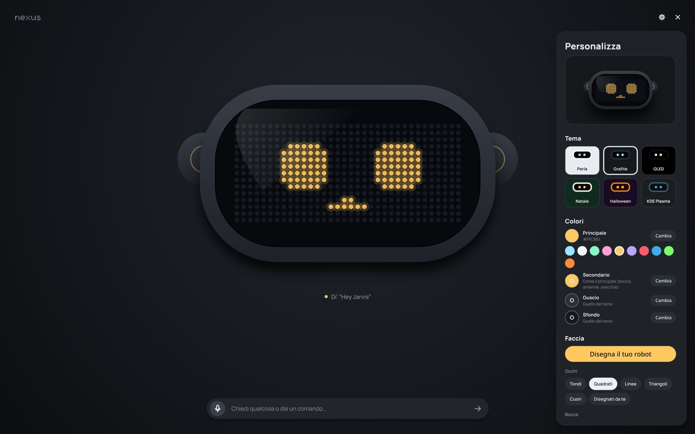
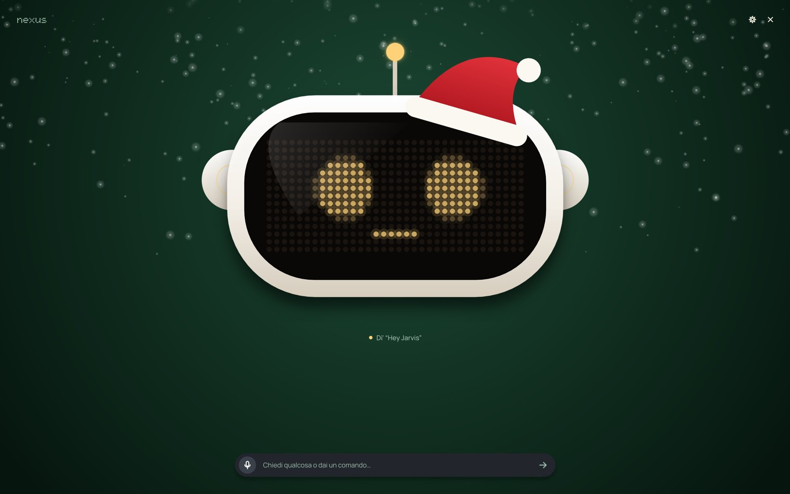
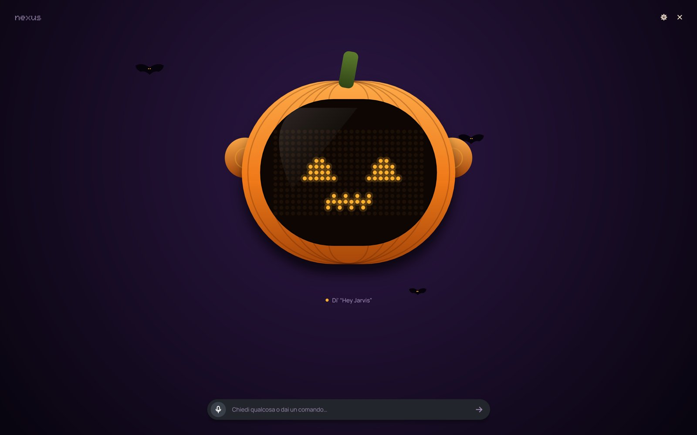

# NEXUS: Notch AI for Linux (e Windows, Android, Wear OS)

Un assistente robot **sempre acceso** che vive dentro il tuo PC Linux. Lo svegli con la voce, ti risponde parlando e
**agisce davvero**: apre app e siti, riordina il desktop, guarda lo schermo, usa mouse e tastiera.
Tutto **in locale**, senza abbonamenti e senza limiti.

In alto c'è un **notch come quello del Mac** che mostra cosa sta facendo, con i sottotitoli in diretta.
Con un clic diventa un **casco robot a schermo intero** con il volto a LED, completamente personalizzabile.



| Natale | Halloween | KDE Plasma |
|---|---|---|
|  |  |  |

## Cosa sa fare

- **Parola di attivazione** ("Hey Jarvis", "Alexa"…) con openWakeWord, oppure pulsante o scorciatoia (`nexus-ctl listen`)
- **Capisce l'italiano** con Whisper large-v3-turbo: volume normalizzato, parole suggerite (nomi delle app, TV),
  pre-ascolto per non perdere le prime parole; capisce da solo quando hai finito di parlare (Silero VAD)
- **Cervello locale**: Qwen 3.5 con visione e tool, tramite Ollama (4B entra tutto in una GPU da 6 GB)
- **Vede lo schermo**: screenshot e OCR con le posizioni dei testi, così sa dove cliccare
- **Mouse e tastiera su Wayland**: dispositivi virtuali uinput con coordinate assolute, precisi a ogni scala
- **App e giochi**: controlla se un programma c'è, lo installa da Flathub (senza password), installa o avvia
  giochi **Steam** per nome ("installami Portal 2", "avvia Counter-Strike 2")
- **Azioni**: apre app, siti e cartelle, cerca sul web, riordina il desktop (con conferma e annulla), comandi da
  terminale (sempre con conferma), volume, batteria
- **Finestre**: "metti Firefox a destra e LibreOffice Writer a sinistra", massimizza, riduci, chiudi
  (tramite script KWin; le app non aperte vengono aperte da sole)
- **Schermo sulla TV**: "condividi lo schermo sulla TV Cucina". Trova le TV in rete (Miracast, Chromecast) e usa
  GNOME Network Displays (Flatpak `org.gnome.NetworkDisplays`)
- **Immagini**: "fammi un'immagine di…" → **Z-Image-Turbo** in locale (stable-diffusion.cpp, circa 40-60 s su
  RTX 3060 6 GB). Un "vigile della GPU" scarica il cervello prima di disegnare, così non si superano i 6 GB
- **Aggiornamenti**: Personalizza → Aggiornamenti → "Aggiorna ora" (git pull + riavvio). Anche l'app Android
  si aggiorna da sola dalle release
- **Terminale e tool diretti**: comandi bash (la cartella resta tra un comando e l'altro), file, appunti, musica,
  luminosità, promemoria, pagine web, Wi-Fi/Bluetooth, processi, blocco/spegnimento. L'agente li preferisce allo schermo
- **Automode / Manuale**: "Hey Jarvis, mettiti in automode" → niente più conferme (anche dal notch o dalle impostazioni);
  i comandi distruttivi restano sempre bloccati
- **Webcam**: "guarda la telecamera, cosa vedi?" → foto e descrizione (schiarisce da sola le stanze buie)
- **Cervello di riserva**: se il cervello scelto non risponde, NEXUS chiede se passare a quello locale (in automode lo fa da solo)
- **Non si chiude per sbaglio**: Alt+F4 viene ignorato, si esce solo da Personalizza → Esci da NEXUS
- **Voce robotica** in italiano (Piper e un filtro robot regolabile) e sottotitoli karaoke sincronizzati
- **Stop vero**: ferma subito voce, ascolto e ragionamento

## App Android (telefono e tablet)

In `android/` c'è NEXUS per Android: **tieni premuto il tasto laterale** (al posto di Gemini) e si apre il robot.
- Apre app, siti, YouTube, sveglie, timer, chiamate e SMS, WhatsApp, navigatore, torcia, volume, impostazioni
- Con l'accessibilità legge lo schermo, tocca pulsanti, scrive, scorre e usa i tasti di sistema
- Controlli del telefono: Non disturbare, suoneria, luminosità, rotazione, qualsiasi interruttore delle impostazioni rapide
- Fotocamera frontale/posteriore ("cosa vedi?"), terminale, automode, cervello di riserva se quello scelto non risponde
- Stessi provider del PC (il tuo PC via Tailscale, OpenAI, Claude, Gemini, Groq…, o Ollama in Termux sul telefono)
- Stesso aspetto: temi, colori, forme ed editor di disegno a LED; layout apposta per i tablet

Scarica l'APK dalle [Release](https://github.com/ALEXLIONBIT/notch-nexus-ai-for-linux/releases). Poi in **Configura**:
microfono, cervello, assistente digitale (Impostazioni → App → App predefinite → Assistente digitale → NEXUS)
e accessibilità. Su Samsung: Funzioni avanzate → Tasto laterale → Tieni premuto → Assistente digitale.

Compilare da soli: `cd android && ./gradlew assembleDebug` (serve Android SDK, JDK 17).

## Windows 10/11

NEXUS gira anche su **Windows**: stesso notch, stesso casco a LED, stessa voce. Scarica `NEXUS-Setup-*.exe`
dalle [Release](https://github.com/ALEXLIONBIT/notch-nexus-ai-for-linux/releases) (cerca "NEXUS per Windows") e aprilo:
non servono permessi da amministratore. Al primo avvio scegli dove ragiona il robot: **su questo PC** (installa da solo
Ollama e il modello giusto per la tua scheda video) oppure **con un provider** (il tuo PC via Tailscale, OpenAI, Claude…).

| Funzione | Linux | Windows |
|---|---|---|
| Mouse e tastiera | uinput (evdev) | SendInput (testo in Unicode, accenti ok) |
| Finestre | script KWin / wmctrl | API Win32 |
| App | file `.desktop`, Flathub | menu Start + app dello Store, **winget** |
| Terminale | bash | **PowerShell** |
| Leggere lo schermo | Spectacle + Tesseract | screenshot + **OCR integrato in Windows** |
| Schermo sulla TV | GNOME Network Displays | Miracast (Win+K) |
| Aggiornamenti | git pull | scarica la nuova release e si reinstalla da solo |

Log: `%LOCALAPPDATA%\NEXUS\nexus.log` · Impostazioni: `%APPDATA%\NEXUS\config.json`.
La build è automatica (GitHub Actions su un Windows vero): `windows/build.py` crea l'app con PyInstaller, la prova
con `NEXUS.exe --selftest` (app, finestre, mouse, OCR, PowerShell, voce, Whisper, cervello, interfaccia) e la
impacchetta con Inno Setup. Si pubblica con un tag `windows-vX.Y.Z`.

## Wear OS (orologio)

In `android/wear/` c'è **NEXUS per Wear OS** (Wear OS 3+: Galaxy Watch 4 e successivi, Pixel Watch…): il robot sul
polso, con la faccia a LED adattata allo schermo tondo. Tocca la faccia (o il microfono) e parla.
- Va su internet da solo (Wi-Fi/LTE dell'orologio o tramite il telefono) e parla direttamente con il tuo cervello
- **Ricerche sul web** con risposte brevi, **meteo**, timer e promemoria, sveglie, app dell'orologio,
  battito cardiaco, volume, musica, torcia, navigatore; apre i link sul telefono
- Cervelli, aspetto e voce arrivano **dall'app NEXUS del telefono** da soli (Cervello → "Invia all'orologio")
- Si può mettere sul tasto dell'orologio come assistente; chat scorrevole con la corona, tastiera per scrivere

Installazione: scarica `nexus-wear-*.apk` dalle Release e installalo sull'orologio con ADB
(`adb pair` / `adb connect` dal debug wireless dell'orologio, poi `adb install nexus-wear-*.apk`).
L'app del telefono e quella dell'orologio devono essere firmate con la stessa chiave.

## Provider: dove gira il cervello

Non serve per forza un PC potente. Da **Personalizza → Cervello** aggiungi uno o più provider e scegli quale usare:

| Provider | Quando usarlo |
|---|---|
| **Ollama su questo PC** | tutto offline, se hai una GPU |
| **Ollama su un altro PC** (in casa o via **Tailscale**, es. `http://100.x.y.z:11434`) | laptop leggero e PC fisso potente. Sull'altro PC avvia Ollama con `OLLAMA_HOST=0.0.0.0` |
| **OpenAI, Anthropic, Google Gemini, Groq, OpenRouter** | con chiave API, per qualsiasi PC |
| **LM Studio, vLLM, llama.cpp** o qualsiasi server compatibile OpenAI | server tuo in rete |

Voce, finestre, mouse e TV girano sempre sul tuo PC; solo il "ragionamento" va al provider.

**Telefono e tablet sul tuo PC**: NEXUS apre una porta locale (`127.0.0.1:8766`) che inoltra il cervello e crea
immagini. Rendila raggiungibile solo dai tuoi dispositivi con `sudo tailscale serve --bg --tcp 11434 tcp://localhost:8766`
e nell'app metti `http://IP-TAILSCALE-DEL-PC:11434` sia come cervello sia come server immagini.
Anche la **trascrizione** può essere precisa (Whisper turbo), leggera (Whisper small) oppure online (OpenAI/Groq).
Le chiavi API restano solo in `config.json` sul tuo PC, che non va mai su GitHub.

## Personalizzazione

- **Temi**: Perla, Grafite, OLED, Natale (neve e cappello), Halloween (zucca e pipistrelli), KDE Plasma
- **Colori liberi**: principale, secondario, guscio, sfondo
- **Faccia**: occhi tondi, quadrati, linee, triangoli, cuori; bocche diverse; LED tondi o a pixel; bagliore
- **Corpo**: casco a capsula, tondo, TV o cubo; antenne; orecchie
- **Disegna il tuo robot**: editor a LED con 9 colori. I tuoi occhi e la tua bocca continuano a sbattere le
  palpebre e a parlare


## Requisiti

- Linux: **KDE Plasma** (Wayland o X11) oppure **Linux Mint / Ubuntu / Debian** (Cinnamon, MATE, XFCE su X11)
- Per il cervello locale: GPU NVIDIA consigliata (testato su RTX 3060 6 GB). Su PC leggeri usa un **provider**
  (altro PC in rete o Tailscale, oppure API online)
- Microfono e casse

| Funzione | KDE Plasma | Linux Mint / altri desktop |
|---|---|---|
| Notch sempre sopra | layer-shell | finestra senza bordi in alto |
| Finestre | script KWin | `wmctrl` |
| Screenshot | Spectacle | gnome-screenshot / X11 |
| Scrivere testo | wl-clipboard | xclip |

> Testato su CachyOS + KDE Plasma. Il supporto per Linux Mint è nuovo: se qualcosa non va, apri una issue.

## Installazione

### In un file: AppImage (il modo più semplice)

Scarica `NEXUS-*-x86_64.AppImage` dalle [release](https://github.com/ALEXLIONBIT/notch-nexus-ai-for-linux/releases)
(quelle `linux-v*`) e aprilo:

```bash
chmod +x NEXUS-*-x86_64.AppImage && ./NEXUS-*-x86_64.AppImage
./NEXUS-*-x86_64.AppImage --permessi    # una volta sola: mouse e tastiera virtuali, poi esci e rientra
```

Al primo avvio si mette nel menu delle app e nell'avvio automatico e chiede dove gira il cervello (Ollama su questo
PC oppure un provider). Si aggiorna da solo. Funziona su Ubuntu 22.04+, Mint, Debian, Fedora, Arch/CachyOS.
Nell'AppImage il notch è una finestra normale: il layer-shell di KDE c'è solo con l'installazione qui sotto.

### Dal codice (script)

```bash
git clone https://github.com/ALEXLIONBIT/notch-nexus-ai-for-linux.git ~/nexus
cd ~/nexus && ./scripts/install.sh
```

Lo script riconosce da solo **pacman** (Arch, CachyOS) o **apt** (Ubuntu, Linux Mint, Debian) e installa tutto:
pacchetti, Python, voci, Whisper, Ollama con il modello, permessi per mouse e tastiera e avvio automatico.
Dopo, esci e rientra una volta, perché serve il gruppo `input` per mouse e tastiera.

**PC poco potente?** Usa `NEXUS_NO_OLLAMA=1 ./scripts/install.sh`, poi da Personalizza → Cervello aggiungi un
provider (un altro PC con Ollama in casa o via Tailscale, oppure OpenAI, Groq…) e scegli la trascrizione
"leggera" oppure "online".

Le impostazioni personali vanno in `config.json`, creato al primo salvataggio dalla UI. Per esempio
`"user_name": "Mario"` fa sì che il robot ti chiami per nome, e `"model": "qwen3.5:9b"` cambia cervello.

> ⚠️ Con GPU da 6 GB carica **un solo modello** per volta: più modelli CUDA insieme possono bloccare il driver NVIDIA.

## Come è fatto

```
mic → wake word → Whisper → Qwen (Ollama, tool calling) → azioni (app, file, schermo, mouse/tastiera)
                                    ↓
                         Piper (voce robot) + eventi → UI (notch + casco, PySide6/QML + layer-shell)
```

- `backend/nexus/`: voce, cervello, tool (Python 3.11)
- `ui/`: notch e casco robot (QML), temi ed editor
- Backend e UI comunicano con JSON su `127.0.0.1:8765`

## English

NEXUS is an always-on, voice-driven AI assistant for Linux (KDE Plasma / Wayland). It shows a macOS-style
notch with live subtitles and a fully customizable LED-face robot helmet. Everything runs locally: openWakeWord,
faster-whisper, Qwen 3.5 via Ollama (vision and tool calling) and Piper TTS. It can open apps, read the screen with
OCR, and control the mouse and keyboard through uinput. The UI is in Italian for now.

## Licenze

- Codice: MIT (vedi `LICENSE`)
- Font Doto e Manrope: SIL Open Font License 1.1 (`ui/fonts/OFL-*.txt`)
- Modelli scaricati a parte con le loro licenze: Qwen (Apache 2.0), Whisper (MIT), Piper voices, openWakeWord
