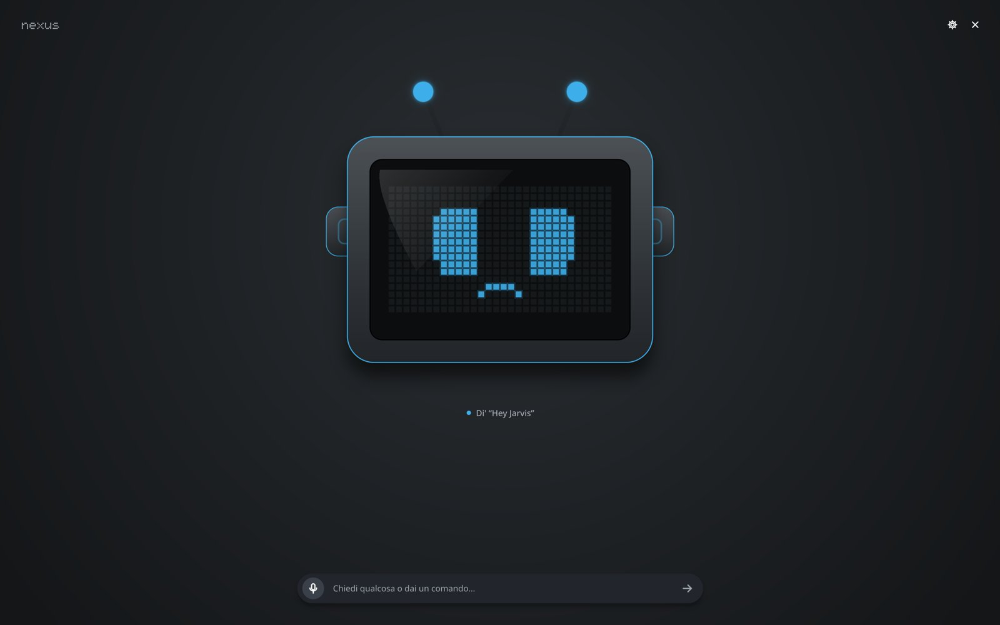
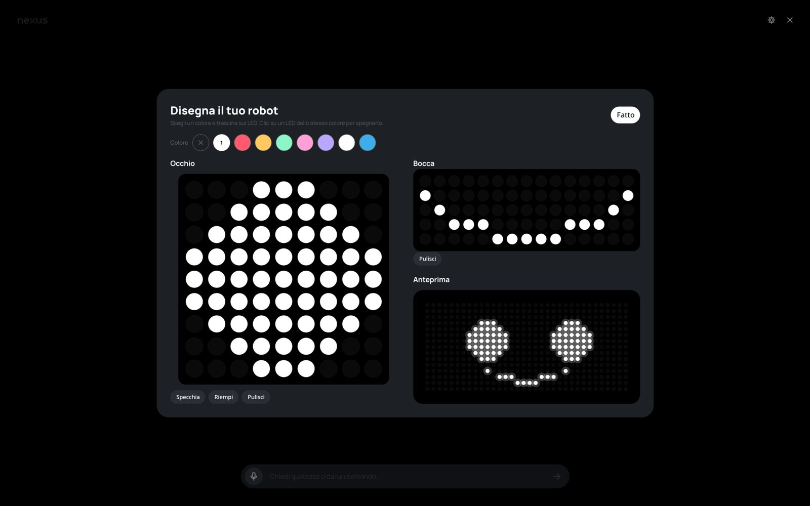

# NEXUS: Notch AI for Linux

Un assistente robot **sempre acceso** che vive dentro il tuo PC Linux. Lo svegli con la voce, ti risponde parlando e
**agisce davvero**: apre app e siti, riordina il desktop, guarda lo schermo, usa mouse e tastiera.
Tutto **in locale**, senza abbonamenti e senza limiti.

In alto c'è un **notch come quello del Mac** che mostra cosa sta facendo, con i sottotitoli in diretta.
Con un clic diventa un **casco robot a schermo intero** con il volto a LED, completamente personalizzabile.


| Natale | Halloween | KDE Plasma |
|---|---|---|
|  |  |  |

## Cosa sa fare

- **Parola di attivazione** ("Hey Jarvis", "Alexa"…) con openWakeWord, oppure pulsante o scorciatoia (`nexus-ctl listen`)
- **Capisce l'italiano** con Whisper large-v3-turbo: volume normalizzato, parole suggerite (nomi delle app, TV),
  pre-ascolto per non perdere le prime parole; capisce da solo quando hai finito di parlare (Silero VAD)
- **Cervello locale**: Qwen 3.5 con visione e tool, tramite Ollama (4B entra tutto in una GPU da 6 GB)
- **Vede lo schermo**: screenshot e OCR con le posizioni dei testi, così sa dove cliccare
- **Mouse e tastiera su Wayland**: dispositivi virtuali uinput con coordinate assolute, precisi a ogni scala
- **App e giochi**: controlla se un programma c'è, lo installa da Flathub (senza password), installa o avvia
  giochi **Steam** per nome ("installami Portal 2", "avvia Counter-Strike 2")
- **Azioni**: apre app, siti e cartelle, cerca sul web, riordina il desktop (con conferma e annulla), comandi da
  terminale (sempre con conferma), volume, batteria
- **Finestre**: "metti Firefox a destra e LibreOffice Writer a sinistra", massimizza, riduci, chiudi
  (tramite script KWin; le app non aperte vengono aperte da sole)
- **Schermo sulla TV**: "condividi lo schermo sulla TV Cucina". Trova le TV in rete (Miracast, Chromecast) e usa
  GNOME Network Displays (Flatpak `org.gnome.NetworkDisplays`)
- **Voce robotica** in italiano (Piper e un filtro robot regolabile) e sottotitoli karaoke sincronizzati
- **Stop vero**: ferma subito voce, ascolto e ragionamento

## Provider: dove gira il cervello

Non serve per forza un PC potente. Da **Personalizza → Cervello** aggiungi uno o più provider e scegli quale usare:

| Provider | Quando usarlo |
|---|---|
| **Ollama su questo PC** | tutto offline, se hai una GPU |
| **Ollama su un altro PC** (in casa o via **Tailscale**, es. `http://100.x.y.z:11434`) | laptop leggero e PC fisso potente. Sull'altro PC avvia Ollama con `OLLAMA_HOST=0.0.0.0` |
| **OpenAI, Anthropic, Google Gemini, Groq, OpenRouter** | con chiave API, per qualsiasi PC |
| **LM Studio, vLLM, llama.cpp** o qualsiasi server compatibile OpenAI | server tuo in rete |

Voce, finestre, mouse e TV girano sempre sul tuo PC; solo il "ragionamento" va al provider.
Anche la **trascrizione** può essere precisa (Whisper turbo), leggera (Whisper small) oppure online (OpenAI/Groq).
Le chiavi API restano solo in `config.json` sul tuo PC, che non va mai su GitHub.

## Personalizzazione

- **Temi**: Perla, Grafite, OLED, Natale (neve e cappello), Halloween (zucca e pipistrelli), KDE Plasma
- **Colori liberi**: principale, secondario, guscio, sfondo
- **Faccia**: occhi tondi, quadrati, linee, triangoli, cuori; bocche diverse; LED tondi o a pixel; bagliore
- **Corpo**: casco a capsula, tondo, TV o cubo; antenne; orecchie
- **Disegna il tuo robot**: editor a LED con 9 colori. I tuoi occhi e la tua bocca continuano a sbattere le
  palpebre e a parlare



## Requisiti

- Linux: **KDE Plasma** (Wayland o X11) oppure **Linux Mint / Ubuntu / Debian** (Cinnamon, MATE, XFCE su X11)
- Per il cervello locale: GPU NVIDIA consigliata (testato su RTX 3060 6 GB). Su PC leggeri usa un **provider**
  (altro PC in rete o Tailscale, oppure API online)
- Microfono e casse

| Funzione | KDE Plasma | Linux Mint / altri desktop |
|---|---|---|
| Notch sempre sopra | layer-shell | finestra senza bordi in alto |
| Finestre | script KWin | `wmctrl` |
| Screenshot | Spectacle | gnome-screenshot / X11 |
| Scrivere testo | wl-clipboard | xclip |

> Testato su CachyOS + KDE Plasma. Il supporto per Linux Mint è nuovo: se qualcosa non va, apri una issue.

## Installazione

```bash
git clone https://github.com/ALEXLIONBIT/notch-nexus-ai-for-linux.git ~/nexus
cd ~/nexus && ./scripts/install.sh
```

Lo script riconosce da solo **pacman** (Arch, CachyOS) o **apt** (Ubuntu, Linux Mint, Debian) e installa tutto:
pacchetti, Python, voci, Whisper, Ollama con il modello, permessi per mouse e tastiera e avvio automatico.
Dopo, esci e rientra una volta, perché serve il gruppo `input` per mouse e tastiera.

**PC poco potente?** Usa `NEXUS_NO_OLLAMA=1 ./scripts/install.sh`, poi da Personalizza → Cervello aggiungi un
provider (un altro PC con Ollama in casa o via Tailscale, oppure OpenAI, Groq…) e scegli la trascrizione
"leggera" oppure "online".

Le impostazioni personali vanno in `config.json`, creato al primo salvataggio dalla UI. Per esempio
`"user_name": "Mario"` fa sì che il robot ti chiami per nome, e `"model": "qwen3.5:9b"` cambia cervello.

> ⚠️ Con GPU da 6 GB carica **un solo modello** per volta: più modelli CUDA insieme possono bloccare il driver NVIDIA.

## Come è fatto

```
mic → wake word → Whisper → Qwen (Ollama, tool calling) → azioni (app, file, schermo, mouse/tastiera)
                                    ↓
                         Piper (voce robot) + eventi → UI (notch + casco, PySide6/QML + layer-shell)
```

- `backend/nexus/`: voce, cervello, tool (Python 3.11)
- `ui/`: notch e casco robot (QML), temi ed editor
- Backend e UI comunicano con JSON su `127.0.0.1:8765`

## English

NEXUS is an always-on, voice-driven AI assistant for Linux (KDE Plasma / Wayland). It shows a macOS-style
notch with live subtitles and a fully customizable LED-face robot helmet. Everything runs locally: openWakeWord,
faster-whisper, Qwen 3.5 via Ollama (vision and tool calling) and Piper TTS. It can open apps, read the screen with
OCR, and control the mouse and keyboard through uinput. The UI is in Italian for now.

## Licenze

- Codice: MIT (vedi `LICENSE`)
- Font Doto e Manrope: SIL Open Font License 1.1 (`ui/fonts/OFL-*.txt`)
- Modelli scaricati a parte con le loro licenze: Qwen (Apache 2.0), Whisper (MIT), Piper voices, openWakeWord
